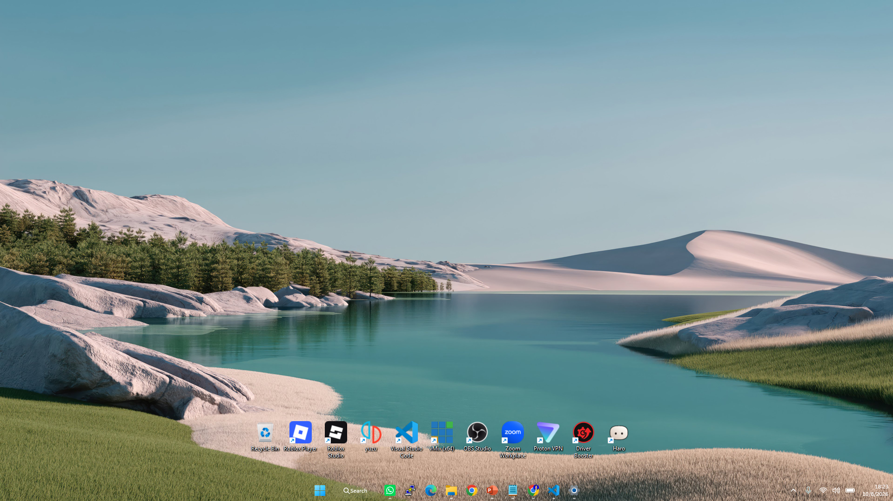
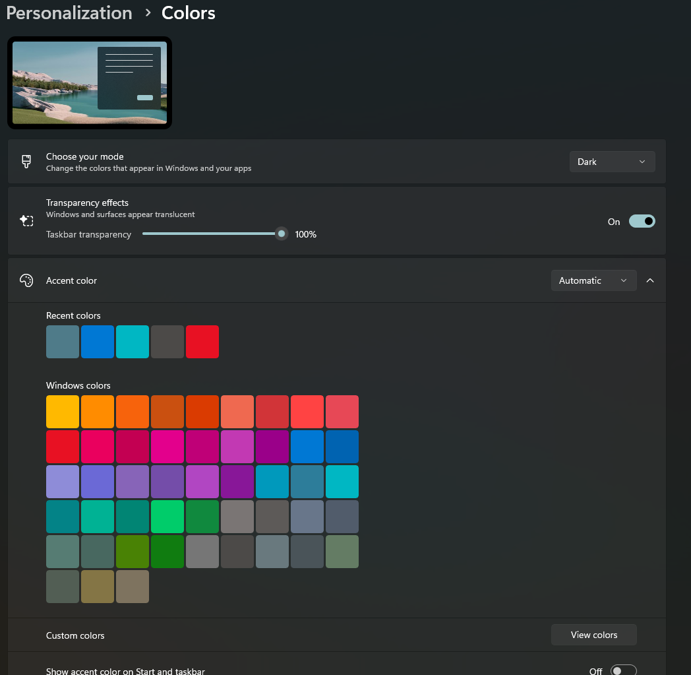

# Transparency Tweak

Add a **Taskbar transparency** slider directly to **Windows Settings > Personalization > Colors**. Adjust the taskbar from its default appearance to fully transparent, with changes applied immediately.

Built for **Windows 11 x64**. Tested on Windows build **26300.9457**; compatibility with other builds has not been verified.

## Preview

### Transparent taskbar



### Slider in Windows Settings



Screenshots show the taskbar at **100% transparency** with Windows transparency effects enabled. The wallpaper and desktop apps shown are illustrative and are not included.

## Features

- A 0-100% slider integrated into the Windows Colors settings page.
- Immediate taskbar updates, with the selected percentage saved for the current user.
- Automatic loading at sign-in and unlock.
- Per-user installation without administrator rights.
- An uninstaller that restores the default Windows taskbar.

## Install or update

1. Download [Install Transparency Tweak.exe](dist/Install%20Transparency%20Tweak.exe) using GitHub's **Download raw file** button, or download and extract this repository using **Code > Download ZIP**.
2. Run the installer and accept its confirmation.
3. Open **Settings > Personalization > Colors**.
4. Turn on **Transparency effects**, then adjust **Taskbar transparency**.

Updating an active older version closes Settings if it uses that version and restarts Explorer when necessary. Open File Explorer windows may close. Your transparency percentage is preserved.

## How the slider works

| Setting | Result |
| --- | --- |
| 0% | Restore the native taskbar brushes. |
| 1-99% | Apply a plain taskbar tint with decreasing opacity. |
| 100% | Make the replacement taskbar fill and border fully transparent. |
| Windows Transparency effects off | Restore the native taskbar brushes regardless of the slider value. |

The replacement uses a plain tint instead of native Acrylic blur. It changes the taskbar background; taskbar icons remain visible.

## Uninstall

Download and run [Uninstall Transparency Tweak.exe](dist/Uninstall%20Transparency%20Tweak.exe), then accept its confirmation. Explorer restarts, so open File Explorer windows will close.

If you already have the source files, you can also run:

```powershell
powershell.exe -NoProfile -ExecutionPolicy Bypass -File .\uninstall.ps1
```

## Build from source

Requires **Visual Studio C++ Build Tools (x64)** with the C++ workload and **Windows SDK**.

```powershell
powershell.exe -NoProfile -ExecutionPolicy Bypass -File .\native\build.ps1
```

This produces the DLL and injector in `native/out/`, plus standalone installer and uninstaller executables in `dist/`. To install from the source tree after building:

```powershell
powershell.exe -NoProfile -ExecutionPolicy Bypass -File .\install.ps1
```

## Files and settings

- Program files: `%LOCALAPPDATA%\TransparencyTweak\app`
- Logs: `%LOCALAPPDATA%\TransparencyTweak\logs`
- Registry: `HKCU\Software\TransparencyTweak\TaskbarTransparency`
- Scheduled task: `TransparencyTweak`

The tweak loads a DLL into Explorer and Settings to customize their UI. It does not modify files in Windows system folders. Because it depends on Windows UI internals, Windows updates may affect compatibility.

See [development notes](docs/DEVELOPMENT.md) for the Settings crash fix, implementation details, and regression test commands.
