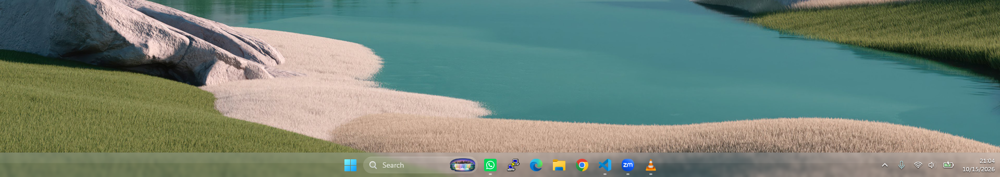
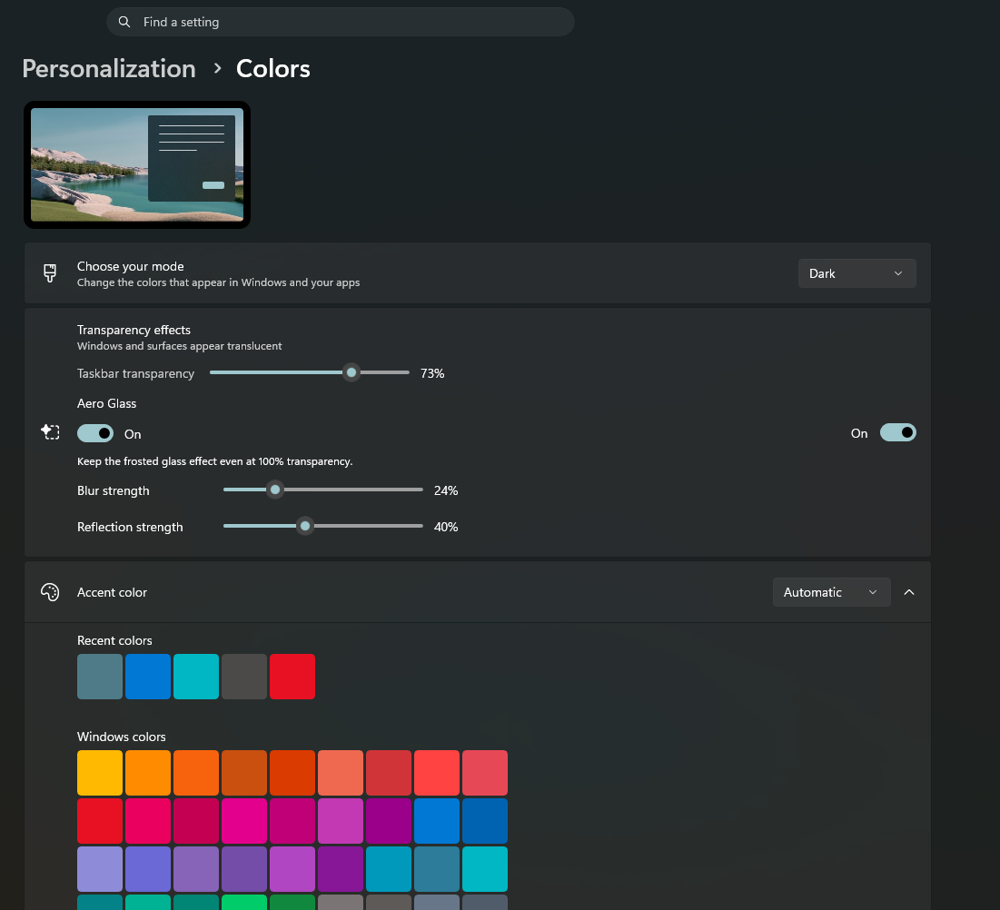

# Transparency Tweak Aero 0.1.0-preview.5

Paket preview terpisah untuk taskbar kaca. Versi ini memakai renderer Windows
Composition yang sudah diuji pada Windows 11 x64 build 26300.9457. Ia tidak
memakai DLL Aero asli Windows 7. Pengaturan tambahan: Aero Glass, Blur strength,
dan Reflection strength. Pada transparansi 100%, blur dan pantulan tetap aktif.

## Paket

- [Installer Aero](../dist/TransparencyTweak-Aero-0.1.0-preview.5/Install%20Transparency%20Tweak%20Aero%200.1.0-preview.5.exe)
- [ZIP lengkap](../dist/TransparencyTweak-Aero-0.1.0-preview.5.zip)
- [Restore Previous Version](../dist/TransparencyTweak-Aero-0.1.0-preview.5/Restore%20Previous%20Version.exe)
- [Petunjuk paket](../dist/TransparencyTweak-Aero-0.1.0-preview.5/README.md)

Tidak perlu uninstall versi sebelumnya. Installer Aero menyimpan binary di
`%LOCALAPPDATA%\TransparencyTweak\versions\aero-0.1.0-preview.5`, tanpa mengganti
binary dalam folder `app` lama. Hanya satu versi aktif: scheduled task yang
sudah ada dialihkan ke versi Aero. Folder rilis `dist` lama tetap tersedia.

Installer menyimpan XML scheduled task dan nilai registry sebelum instalasi
di `previous-version.json` dalam folder versi tersebut. Restore Previous Version
mengembalikan konfigurasi dan versi yang disimpan, serta mempertahankan binary
Aero. Pada instalasi baru tanpa versi sebelumnya, restore kembali ke default
Windows. Jika versi yang aktif sebelumnya adalah prototipe Aero, restore juga
kembali ke prototipe itu; untuk kembali ke plain tint, jalankan installer stabil.

Instalasi/pergantian versi memerlukan restart Explorer dan dapat menutup
jendela File Explorer serta Settings yang memakai tweak. Jangan memakai
uninstaller lama hanya untuk berganti versi: ia menghapus seluruh direktori
TransparencyTweak, termasuk subfolder versi. Gunakan uninstaller lama hanya
jika ingin menghapus seluruh aplikasi.

## Ukuran mask jam pada Preview 5

Screenshot pengguna memperlihatkan shadow jam mengecil dan bergeser ke kiri.
Penyebab yang berhasil direproduksi: ukuran SpriteVisual diambil dari
ActualWidth/ActualHeight, yang pada TextBlock melaporkan ukuran isi teks,
bukan ukuran elemen setelah arrange. Mask jam mencakup area layout yang lebih
lebar beserta alignment-nya, sehingga diperkecil ketika dipasang pada visual
selebar angka jam. Preview 5 memakai UIElement.ActualSize untuk dimensi mask.

Regresi Stretch + TextAlignment Right gagal dengan kode lama: ink 29 DIP,
area arrange 96 DIP, shadow 29 DIP. Kode baru lulus dengan shadow 96 DIP.
Build Aero/stable, probe glass, dan simulasi paket lulus. Preview 5 sudah aktif;
log jam asli menunjukkan area mask sekitar 63x16 DIP dan ink 29x16 DIP.
Pengguna mengonfirmasi hasil perbaikan pada 15 Oktober 2026 dan memberikan
screenshot terbaru taskbar serta halaman Colors, ditampilkan di bawah.
Rincian dan referensi ada di [catatan shadow](TRAY-SHADOW.md).

## Screenshot Preview 5





Pengaturan pada screenshot: Taskbar transparency 73%, Aero Glass on,
Blur strength 24%, Reflection strength 40%. Wallpaper dan aplikasi desktop
yang terlihat bukan bagian dari paket.

## Perubahan host pada Preview 4

Pengguna melaporkan shadow Preview 3 terlihat pada ikon/tanggal tetapi tidak
pada jam. Log Preview 3 membuktikan mask jam diperbarui setiap menit; log itu
tidak membuktikan hasil piksel. Preview 4 mengganti Canvas berukuran eksplisit
0x0 dengan Canvas yang mengikuti ukuran Grid dan membentang semua baris/kolom.
Host tetap tidak meminta ruang layout dan tidak dimasukkan ke StackPanel jam.

Probe baru menguji jam/tanggal terpisah, rata kanan, dua baris, pembungkus
StackPanel, ukuran host, posisi foreground, serta update dan cleanup. Uji ini
lulus. Preview 4 sudah aktif; host jam di tray asli tercatat 62x40 DIP dengan
opacity 1.0. Pergantian menit alami pada 20:53 WIB, 15 Oktober 2026,
memperbarui mask jam dengan ukuran host tersebut. Pengguna tetap melaporkan
shadow jam salah; perubahan host ini belum mengatasi skala mask, yang kemudian
direproduksi dan diperbaiki pada Preview 5.

## Shadow system tray yang ditambahkan pada Preview 3

Preview 3 menambahkan shadow hitam tipis mengikuti bentuk teks/gambar pada ikon
tray dan jam/tanggal. Radius 2,5 DIP, opacity 85%, offset ke bawah 1 DIP.
Foreground dan parameter blur/pantulan tidak diubah. Shadow dilepas saat
transparansi 0% atau Transparency effects off. Rincian implementasi dan uji
terpisah ada di [catatan shadow](TRAY-SHADOW.md). Paket Preview 1/2 tetap tersedia.

Build Aero dan stable compile check berhasil. Probe XAML terpisah lulus untuk
mask teks/gambar, urutan di belakang konten, pembaruan jam, disable/enable dan
cleanup. Installer Preview 3 juga berhasil diaktifkan pada sesi Windows nyata;
log mencatat shadow terpasang pada TimeInnerTextBlock, DateInnerTextBlock dan
glyph ikon tray. Uji mati/nyala shadow di tray asli juga lulus dan memulihkan
preferensi awal. Pemeriksaan log bukan verifikasi tampilan piksel; penilaian
visual pada latar terang/gelap masih memerlukan konfirmasi pengguna.

## Perbaikan verifikasi installer pada Preview 2

Preview 1 memeriksa semua proses Explorer sekali, segera setelah injector
selesai. Pesan `Expected DLL was not loaded as the only tweak in Explorer`
tidak membedakan DLL yang belum siap, DLL yang berbeda, atau modul dalam
proses File Explorer lain. Pesan itu sendiri belum membuktikan penyebabnya.

Preview 2 memeriksa Explorer pemilik taskbar, sesuai target injector, dan
menunggu hingga sekitar 15 detik untuk DLL yang diharapkan. Tetap hanya satu
DLL tweak dengan SHA256 yang sesuai yang diterima dalam proses tersebut.
Frontend juga memilih Windows PowerShell 64-bit secara eksplisit pada Windows
64-bit. Jika verifikasi gagal, PID, path DLL, hash aktual/harapan, dan arsitektur
PowerShell dicatat di `%LOCALAPPDATA%\TransparencyTweak\logs\aero-install.log`.
Log injector tersedia di folder yang sama sebagai `injector.log`.

Jika pemasangan preview 1 dan pemulihan otomatis sama-sama gagal, jalankan
installer stabil untuk memulihkan versi plain tint, lalu coba installer preview 2.
Tidak perlu menghapus folder program atau memakai uninstaller lama.
Perbaikan ini diuji dengan simulasi; penyebab pada PC lain masih memerlukan
log apabila error berulang. Binary renderer dan injector preview 2 sama dengan
preview 1; perubahan ada pada installer dan pemeriksaannya.

## Build dan verifikasi

```powershell
powershell.exe -NoProfile -ExecutionPolicy Bypass -File .\native\experimental\build-aero-package.ps1 -Version 0.1.0-preview.5
powershell.exe -NoProfile -ExecutionPolicy Bypass -File .\native\experimental\Test-AeroPackage.ps1 -Version 0.1.0-preview.5
```

Untuk rilis berikutnya, berikan `-Version 0.1.0-preview.6`. Builder menolak
folder versi yang sudah ada. Proses build tidak mengaktifkan atau menginstal
paket ke Windows. Hash binary dan installer stabil diperiksa tetap sama.

Pemeriksaan paket memverifikasi resource yang tertanam di EXE dan semua
checksum. Uji simulasi Windows API memeriksa pergantian versi, rollback saat
injector gagal, pemulihan task/preferensi, penjagaan binary lama, dan penolakan
jika versi aktif lain atau binary sebelumnya berubah. Uji tambahan memeriksa
keterlambatan DLL, proses Explorer lain, serta penolakan/log/rollback ketika
DLL di taskbar salah atau ada dua DLL tweak. Probe graph Composition
lolos 20.000 perubahan parameter tanpa membangun ulang factory/brush.

Installer Preview 5 sudah dijalankan pada sesi Windows nyata. Pengguna sudah
memeriksa tampilan tray dan memberikan screenshot kontrol Colors. Skenario rollback
dan kegagalan installer diuji melalui simulasi task, registry, proses dan injector.
Kontrol Colors belum diverifikasi melalui otomasi UI. Pengujian rendering dan RAM
versi sebelumnya tercatat di [catatan prototipe](AERO-TASKBAR-PROTOTYPE.md).
