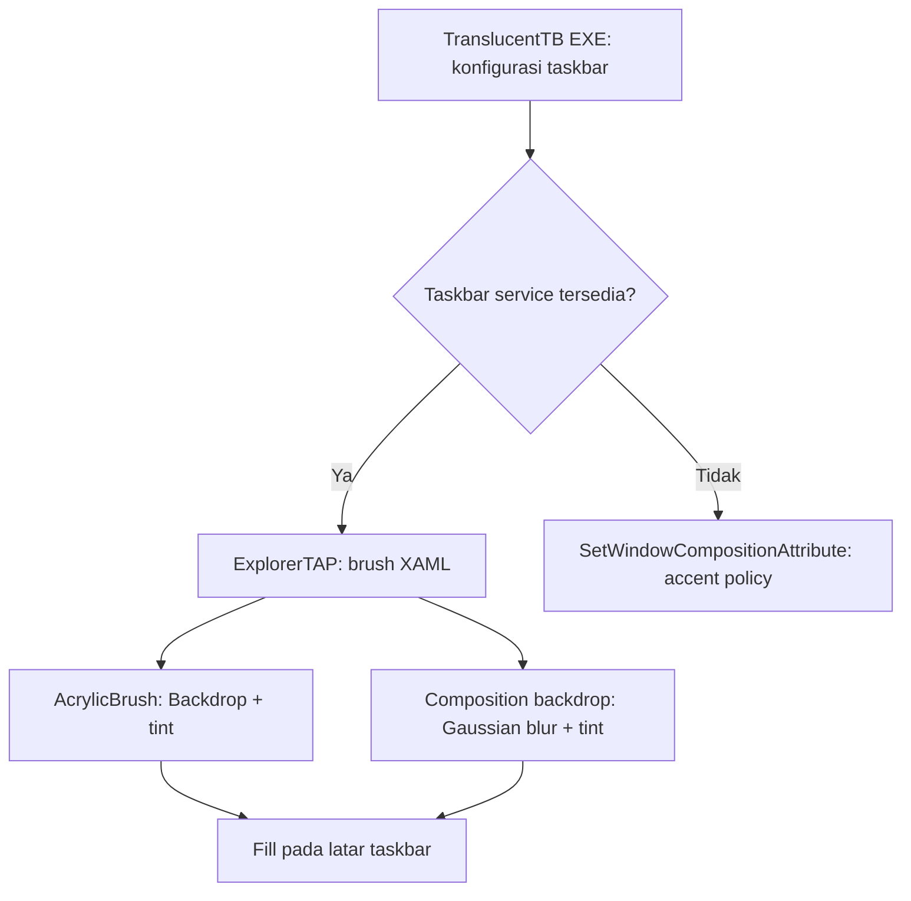

# Inspeksi TranslucentTB dengan REA

Tanggal: 14 Oktober 2026. Fokus: mekanisme glass blur taskbar dan kaitannya
dengan Transparency Tweak. Analisis statis menggunakan REA dan Ghidra 12.1.4;
TranslucentTB tidak dijalankan atau diinstal.

## Hasil utama

TranslucentTB 2026.2 memiliki dua renderer: layanan brush XAML untuk taskbar
modern, dan accent policy Win32 untuk jalur lain. Binary rilis memuat Acrylic
bawaan serta Gaussian blur berbasis Windows Composition yang dapat diatur.
Karena itu, batasan Blur pada README upstream tidak boleh digeneralisasi
menjadi ketiadaan blur pada seluruh taskbar Windows 11 modern.

Renderer proyek ini saat diperiksa membuat `SolidColorBrush` pada
`native/TweakTap.cpp`, sekitar baris 311–320. Jalur itu mengatur tint dan
transparansi; untuk menghasilkan blur seperti TranslucentTB perlu ada brush
efek Acrylic atau Composition. Keberadaan kode tersebut belum membuktikan
hasil visual pada build Windows 26300.9457.

## Identitas target dan provenance

Unduhan: [rilis resmi 2026.2](https://github.com/TranslucentTB/TranslucentTB/releases/tag/2026.2),
asset `TranslucentTB-portable-x64.zip`. Metadata GitHub disimpan di
`research/translucenttb-2026.2/release.json`.

| Artifact | SHA-256 |
| --- | --- |
| ZIP portable x64 | `0dbe8e0255c20e131cde536dcd0ae490d45989a7d360e26d0150dff1922ac420` |
| TranslucentTB.exe | `f933f5bf70405e13feadbcc53883f2676b5a8a1dae214b52c0fe0971c583a0ff` |
| ExplorerTAP.dll | `c48f1a06168acd7839269dde0d15ccf5d09c702512b94dd6ba9a05df1b153dc2` |

EXE dan DLL adalah PE x86-64. File version EXE:
`2026.2.0.d4636e4`. Checkout source yang sudah tersedia di
`.tools/TranslucentTB-research/` berada pada commit
`d4636e439865df0a1a1419db408e055740ce5c74`, sama dengan commit tag rilis.
Source digunakan untuk menjelaskan nama metode dan slot ABI yang tidak diberi
nama oleh decompiler; kesesuaian commit bukan bukti reproducible build.

ZIP berisi delapan file: dua gambar SplashScreen, `ExplorerHooks.dll`,
`ExplorerTAP.dll`, `ProgramLog.dll`, `resources.pri`, `TranslucentTB.exe`,
dan `Xaml.dll`.

`open_binary` REA berhasil mengidentifikasi ZIP. `inspect_artifact` dan
`extract_artifact` menolak entry `Assets\\SplashScreen.jpeg` sebagai path unsafe.
Inventory dan ekstraksi kemudian dilakukan melalui .NET ZipFile, dengan
normalisasi absolute path dan pengecekan bahwa setiap tujuan berada di bawah
folder `research/translucenttb-2026.2/extracted/`. Tidak ada klaim bahwa graph
archive REA berhasil dihasilkan.

## Temuan dari binary

Nama metode pada tabel adalah interpretasi dengan bantuan source pada commit
rilis; alamat fungsi, cabang, panggilan dan konstanta berasal dari REA.

| Pertanyaan | Pengamatan dan interpretasi | Fungsi / Evidence |
| --- | --- | --- |
| Bagaimana renderer dipilih? | EXE bercabang berdasarkan ada/tidaknya taskbar service. Dengan service, accent 3 memanggil slot blur dengan parameter dibagi `3.0`; accent 4 memilih brush Acrylic. Tanpa service, EXE memanggil pointer API composition dengan attribute `0x13` dan payload 16 byte. Source mengidentifikasinya sebagai `WCA_ACCENT_POLICY` melalui `SetWindowCompositionAttribute`. | EXE `0x140046f20`; E1 |
| Bagaimana Acrylic dibuat? | Factory mengaktifkan `Windows.UI.Xaml.Media.AcrylicBrush`; pemanggil memasang nilai `1` pada setter slot `0x38`, tint pada slot `0x48`, lalu brush ke Shape Fill. Source/generated ABI mengidentifikasi nilai 1 sebagai `AcrylicBackgroundSource::Backdrop`. | TAP `0x1800179c0`, `0x180018800`; E2, E3 |
| Bagaimana custom blur dibuat? | Service mengambil visual/compositor elemen, menormalisasi channel warna dengan `/255.0`, menyimpan blur amount dan tint pada objek custom brush, lalu memasang brush pada Fill. | TAP `0x180018cc0`; E4 |
| Apakah graph blur benar-benar ada di rilis? | Fungsi efek membuat objek `GaussianBlurEffect`, sumber bernama `backdrop`, `FloodEffect`, dan `CompositeEffect`; memasukkan dua sumber ke composite dan menghubungkan backdrop ke effect brush. Source menjelaskan graph sebagai CreateBackdropBrush → GaussianBlur + tint Flood → SourceOver → CompositionBrush. | TAP `0x18001e920`; E5 |
| Elemen mana yang diubah? | Callback membandingkan tipe `Windows.UI.Xaml.Shapes.Rectangle`, nama `BackgroundFill` / `BackgroundStroke`, lalu mencari ancestor `TaskbarFrame` sebelum registrasi. Ada jalur penanganan mutation removal. | TAP `0x18001d100`; E6 |
| Bagaimana masuk ke Explorer? | Export `InjectExplorerTAP` mengambil thread/PID taskbar, memasang thread hook dengan `SetWindowsHookExW(4, ...)`, menunggu event sampai 35 detik, melepas hook dan mengambil COM active object. Fungsi pemasangan memuat `Windows.UI.Xaml.dll` serta me-resolve `InitializeXamlDiagnosticsEx`. | TAP `0x180003c00`, `0x1800090e0`; E7, E8 |
| Apakah EXE memakai komponen tersebut? | Konstruktor worker me-resolve `SetWindowCompositionAttribute`, `InjectExplorerHook` dari ExplorerHooks.dll dan `InjectExplorerTAP` dari ExplorerTAP.dll. Resolusi export tidak berarti semua komponen dipasang pada semua tipe taskbar. | EXE `0x14004ade0`; E9 |

### Backdrop dan HostBackdrop

Source rilis memilih `Backdrop` untuk Acrylic. Komentar source menjelaskan
bahwa window taskbar transparan membuat konten di belakangnya tersedia bagi
XAML, dan pilihan ini menghindari perilaku nonaktif `HostBackdrop`.
REA mengamati pemanggilan setter dengan nilai 1; penjelasan alasan desain
berasal dari source, bukan pengamatan runtime.

Ini konsisten dengan catatan riset sebelumnya di
`docs/TRANSLUCENTTB-BLUR-RESEARCH.md`. Penyebab pasti latar opaque pada
prototipe terdahulu tetap belum dibuktikan oleh inspeksi ini.

## Evidence yang disimpan

Bundle akhir: `research/translucenttb-2026.2/translucenttb-evidence.json`.
Bundle TAP sebelum pindah ke EXE:
`research/translucenttb-2026.2/explorertap-evidence.json`.
Bundle akhir mempertahankan dossier penuh, termasuk pseudocode, assembly,
referensi, API observations, value flow, dan keterbatasan provider. REA session
ditutup setelah ekspor.

| Label | Evidence ID |
| --- | --- |
| E1 | `ev_bea599515364ed003d2c442b4078f683940ead7c9305e136810a809e4b44137b` |
| E2 | `ev_69ec4b688e2cfe964e37eb94f0c34fe9411a43c0c56075bdc4acbe46907f44d5` |
| E3 | `ev_7c4ac753c277e25cb6611baae2bb28e2d625fcda69bca80137630a573d6724a9` |
| E4 | `ev_ce04e0766da181cec28cedfab8e496608e569a80be29daf3f5eb13f6e35d70ad` |
| E5 | `ev_c608399b33138b8de07be02e938f22425b934ebdee7f6c20dd6d36b5e9015aac` |
| E6 | `ev_aa16b8c5d232cd8e04f853f686634d438181ebc42b6c86d3ecd76f480d9d93c1` |
| E7 | `ev_1577879e46aaee22093166cb8fd87c36b2a10534d1f6d923a7af6a5c3ce1d93f` |
| E8 | `ev_04e0820a237eb3af84f15cbd5ab7b74e7f0742a49fafb6d5f019982d504ba5c1` |
| E9 | `ev_f09e0772cad50812ea896edcff02557de4843a817bb94e5cfff8dc36dd9b2c77` |

## Implikasi untuk Transparency Tweak

Pilihan implementasi untuk percobaan berikutnya:

1. Uji Acrylic dengan `Backdrop` pada taskbar transparan.
2. Untuk blur strength yang dapat diatur, buat Composition effect brush memakai
   compositor elemen taskbar. Pisahkan blur amount dari tint alpha.
3. Batasi pencocokan BackgroundFill/BackgroundStroke pada ancestor TaskbarFrame;
   simpan native Fill untuk restore, dan kelola lifetime tiap taskbar/monitor.
4. Verifikasi piksel dengan pola di belakang taskbar, fokus berpindah ke window
   lain, perubahan tema, restart Explorer, dan konfigurasi multi-monitor.

Ini adalah rekomendasi implementasi, bukan perubahan yang sudah diterapkan.

## Batas inspeksi dan status pertanyaan

- Mekanisme Acrylic/custom blur, target elemen, dan dispatch EXE: terjawab secara
  statis melalui binary, dengan interpretasi ABI dibantu source rilis.
- Hasil visual dan stabilitas di build 26300.9457: belum diuji.
- Kinerja/GPU, kebocoran resource, serta perilaku semua dynamic state: belum
  diukur atau ditelusuri menyeluruh.
- ExplorerHooks.dll, ProgramLog.dll dan Xaml.dll: diinventarisasi, belum
  didekompilasi. Analisis ini bukan audit keamanan seluruh aplikasi.
- Start menu, menu klik kanan, dan isi File Explorer: fungsi yang ditelusuri
  menargetkan taskbar. Inspeksi ini tidak memberikan bukti bahwa TranslucentTB
  dapat menjadikan seluruh menu/jendela tersebut glass blur.
- Pseudocode adalah rekonstruksi decompiler, bukan source asli atau bukti
  eksekusi. Panggilan COM tidak langsung memerlukan interpretasi ABI. REA juga
  melaporkan batasan pada analisis native dan recovery control flow; rincian
  lengkap dipertahankan dalam tiap Evidence.

## Source untuk interpretasi

- [TaskbarAppearanceService](https://github.com/TranslucentTB/TranslucentTB/blob/d4636e439865df0a1a1419db408e055740ce5c74/ExplorerTAP/taskbarappearanceservice.cpp)
- [XamlBlurBrush](https://github.com/TranslucentTB/TranslucentTB/blob/d4636e439865df0a1a1419db408e055740ce5c74/ExplorerTAP/XamlBlurBrush.cpp)
- [TaskbarAttributeWorker](https://github.com/TranslucentTB/TranslucentTB/blob/d4636e439865df0a1a1419db408e055740ce5c74/TranslucentTB/taskbar/taskbarattributeworker.cpp)
- [TAPSite](https://github.com/TranslucentTB/TranslucentTB/blob/d4636e439865df0a1a1419db408e055740ce5c74/ExplorerTAP/tapsite.cpp)
